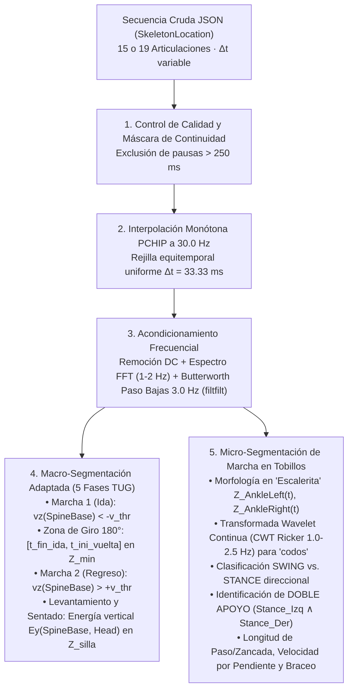

# ANÁLISIS TÉCNICO EXHAUSTIVO, ALGORITMO DE SEGMENTACIÓN Y AUDITORÍA DE DATOS ÓPTICOS (e-Motion / VIMOV)
> **Proyecto de Grado:** Caracterización Cinemática y Clasificación del Test *Timed Up and Go* (TUG) en la Enfermedad de Parkinson Mediante Unidades de Medición Inercial y Cámaras de Profundidad RGB-D
> **Metodología:** CRISP-DM — Fases de *Data Understanding*, *Data Preparation* y *Modeling*
> **Fecha de Consolidación:** 02 de Noviembre de 2026 · Semana 13
> **Autores:** Esteban Guarín Valencia, Juan José Arias Gallego, Santiago Gómez Robledo, Heiner Danit Rincón Carrillo
> **Ubicación de Archivos:** Carpetas [`Datos e-Motion/TUG/`](file:///home/guarinve/Documentos/PDG-TUG/Datos%20e-Motion/TUG) y [`Datos e-Motion/GAIT/`](file:///home/guarinve/Documentos/PDG-TUG/Datos%20e-Motion/GAIT)

---

## 1. Resumen Ejecutivo del Repositorio Activo de Datos e-Motion

El repositorio óptico consolidado en `Datos e-Motion/` reúne **225 grabaciones tridimensionales** capturadas mediante cámaras de profundidad RGB-D (Intel RealSense D455/D455F y Orbbec Astra 2) integradas en la plataforma clínica **e-Motion / VIMOV** de la Universidad Icesi. A diferencia de los sensores inerciales (IMUs), que registran aceleraciones lineales y velocidades angulares en marcos locales adheridos al cuerpo, el sistema e-Motion mide la **posición absoluta tridimensional $(X, Y, Z)$ en metros** de las articulaciones del participante respecto al marco óptico fijo de la cámara.

Conforme a las directrices metodológicas y biomecánicas del proyecto, el repositorio se estructura en dos subconjuntos complementarios:
1. **[`Datos e-Motion/TUG/`](file:///home/guarinve/Documentos/PDG-TUG/Datos%20e-Motion/TUG) (130 archivos):** Grabaciones correspondientes al protocolo *Timed Up and Go* estándar (incorporarse de la silla a $\sim 4.0\text{ m}$, caminar $3\text{ m}$ hacia la cámara, girar $180^\circ$ frente al sensor, regresar a la silla y sentarse).
2. **[`Datos e-Motion/GAIT/`](file:///home/guarinve/Documentos/PDG-TUG/Datos%20e-Motion/GAIT) (95 archivos):** Grabaciones del protocolo de marcha continua lineal (*Gait Analysis* / 10 metros en pasillo), compuestas por **93 series esqueléticas clínicas completas** y **2 archivos tabulares de métricas comparativas** entre sensores. Este subconjunto permite evaluar parámetros locomotores puros en estado estacionario sin la interferencia del giro ni de las transiciones en silla.

---

### 1.1 Censo y Distribución del Dataset Activo

| Métrica / Parámetro | Cantidad en Disco | Muestras Clínicas Analizadas | Descripción y Propósito |
|:---|:---:|:---:|:---|
| **Total de Archivos JSON en `Datos e-Motion/`** | **225** | **223** | 223 series esqueléticas 3D + 2 resúmenes tabulares de métricas comparativas |
| **Protocolo TUG (`Datos e-Motion/TUG/`)** | **130** | **130** | 102 pacientes con Parkinson, 26 controles y 2 sin clasificar |
| **Protocolo Marcha Continua 10m (`Datos e-Motion/GAIT/`)** | **95** | **93** | 83 pacientes con Parkinson, 6 controles de brigada, 4 sin etiqueta + 2 métricas |
| **Pacientes con Parkinson (`PATIENT`)** | **185** | **185** | 102 en TUG + 83 en Marcha Continua de 10 metros |
| **Controles Clínicos de Brigada (`CONTROL`)** | **9** | **9** | 3 en TUG + 6 en Marcha Continua |
| **Controles Sanos de Laboratorio (`CONTROL_LAB`)** | **23** | **23** | 23 pruebas TUG en Laboratorio de Biomecánica Icesi |
| **Muestras Sin Etiqueta Diagnóstica (`SIN_ETIQUETA`)** | **6** | **6** | 2 en TUG + 4 en Marcha Continua |
| **Métricas Comparativas Precalculadas (`METRICS`)** | **2** | -- | Evaluaciones comparativas directas Intel vs. Orbbec |
| **Sujetos Únicos Evaluados en Plataforma VIMOV** | **70** | **70** | Cohortes clínicas `LARGE_PD` y `GEOREF` |
| **Sujetos con Pareo Intra-Sujeto (TUG + Marcha 10m)** | **48** | **48** | Evaluados en ambos protocolos en la misma fecha |
| **Pares Bimodales Validados IMU ↔ e-Motion TUG** | **41** | **41** | Pareo estricto con 100% de coincidencia en género y fecha |

---

### 1.2 Nueva Nomenclatura Estandarizada de Archivos e-Motion

Todos los archivos del repositorio óptico se nombran bajo la estructura sistemática y unificada:

$$\mathbf{\{ORIGEN\}\_\{ID\_EMOTION\}\_eMotion\_\{IMU\_MATCH\}\_\{TIPO\}.json}$$

Donde:
* **`{ORIGEN}`:** Prefijo de ubicación de captura: `SMR` (Brigada Santa Marta), `CST` (Brigada CST / La Victoria) o `LAB` (Laboratorio Icesi).
* **`{ID_EMOTION}`:** Identificador propio y secuencial de la grabación e-Motion (`P1`, `P2`, `P3`, etc.).
* **`eMotion`:** Distintivo constante del sistema óptico.
* **`{IMU_MATCH}`:** Si la grabación coincide con un ensayo inercial IMU verificado, lleva el identificador del sujeto IMU (ej. `P49`, `P06`, `P54`). Si no tiene correspondencia IMU, lleva **`NO`**.
* **`{TIPO}`:** Protocolo biomecánico evaluado: **`TUG`** (en `Datos e-Motion/TUG/`) o **`GAIT`** (en `Datos e-Motion/GAIT/`).

**Ejemplos Reales del Repositorio:**
* `LAB_IDE1_TUG_NO.json`: Primera prueba TUG en laboratorio, sin sensor IMU.
* `SMR_IDE1_TUG_P06.json`: Prueba TUG en Santa Marta del paciente e-Motion P1, con concordancia con el sensor IMU del sujeto P06.
* `SMR_IDE1_GAIT_P06.json`: Prueba de marcha continua 10m en Santa Marta correspondiente al mismo sujeto P06.
* `CST_IDE1_TUG_P54.json`: Prueba TUG en CST con cámara Orbbec Astra 2, correspondiente al sujeto IMU P54.
* `CST_IDEM1_GAIT_NO.json`: Archivo de métricas comparativas tabulares en marcha continua.

---

## 2. Identificación de Sujetos, Cohortes Clínicas y Pareo Multimodal

### 2.1 Vinculación con los Estudios Clínicos (`LARGE_PD` y `GEOREF`)

Mediante el cruce de los identificadores `Patient.Id` y `vimov_test_id` con el padrón clínico de la plataforma VIMOV (conservando anonimización estricta sin nombres propios ni números de cédula), se reconstruyó la trazabilidad de **70 participantes únicos**:
* **Cohorte `LARGE_PD` (Estudio Latinoamericano de Genética en Enfermedad de Parkinson):** Pacientes codificados en VIMOV bajo la nomenclatura `LARGE_PD_843` a `LARGE_PD_894` y controles bajo `LARGE_PD_042C`.
* **Cohorte `GEOREF` (Georreferenciación Clínica):** Participantes codificados bajo `GEOREF401` a `GEOREF461` (incluyendo controles explícitos como `GEOREF415` y `GEOREF419`).
* **Sujetos con Pareo Intra-Sujeto TUG + Marcha Continua (48 pacientes):** Se verificó que **48 participantes únicos** ejecutaron tanto la prueba TUG (`Datos e-Motion/TUG/`) como la prueba de Marcha Continua de 10 metros (`Datos e-Motion/GAIT/`), permitiendo comparar directamente la locomoción del mismo paciente con y sin la exigencia motora de levantarse y girar $180^\circ$.

---

## 3. Diferencias Técnicas, Estructurales y de Hardware entre Archivos JSON

### 3.1 Dos Generaciones de Esquema Esquelético: `v1.2.0` (19 Articulaciones) vs. `v1.3.0` (15 Articulaciones)

De manera análoga a la diferencia entre el Kit `Base` y el Kit `K1` descubierta en los sensores IMU, la auditoría estructural de las grabaciones esqueléticas reveló dos esquemas de software/topología articular distintos:

| Característica Técnica | Esquema Generación 1 (`v1.2.0`) | Esquema Generación 2 (`v1.3.0` / `v0.3.6`) |
|:---|:---:|:---:|
| **Total de Archivos Esqueléticos** | **101 archivos** (3 en `TUG/` + 98 en `GAIT/`) | **122 archivos** (127 en `TUG/` + -) |
| **Valor de `TypeTest`** | `"Gait Analysis"` y `"Timed up and Go"` | `"TIMED_UP_AND_GO"` y `"GAIT_COMPLETE"` |
| **Número de Articulaciones (`JointType`)** | **19 articulaciones** | **15 articulaciones** |
| **Nodos de Columna y Cabeza** | `SpineBase`, `MidSpine`, `ShoulderSpine`, `Neck`, `Head` | `SpineBase`, `BodyCenter`, `Head` |
| **Nodos de Miembros Superiores** | `Left/RightShoulder`, `Left/RightElbow`, `WristLeft/Right`, `Left/RightHand` | `Left/RightShoulder`, `Left/RightElbow`, `WristLeft/Right` (sin `Hand`) |
| **Nodos de Miembros Inferiores** | `Left/RightHip`, `Left/RightKnee`, `AnkleLeft/Right` | `Left/RightHip`, `Left/RightKnee`, `AnkleLeft/Right` |
| **Comportamiento en Pérdida de Tracking** | Conserva las 19 llaves con `JointTrackingState = "NotTracked"` | Reduce la lista `JointLocation` a **solo 2 elementos** en `(0, 0, 0)` |
| **Nodo Universal de Centro Pélvico** | **`SpineBase` (presente en el 100% de los archivos)** | **`SpineBase` (presente en el 100% de los archivos)** y `BodyCenter` |

> [!IMPORTANT]
> **Regla de Invarianza Topológica para el Algoritmo de Segmentación:** Para estimar la velocidad de traslación del centro de masa corporal, se consulta el nodo `Hip Center`. En la topología de SDK de e-Motion/Kinect, el nodo anatómico correspondiente a `Hip Center` se denomina **`SpineBase`**, el cual está presente en el **100% de los archivos esqueléticos**, mientras que `BodyCenter` está ausente en los archivos `v1.2.0`. Por consiguiente, todo el pipeline estandariza la extracción pélvica sobre **`SpineBase`** (con respaldo en `BodyCenter`).

---

### 3.2 Auditoría de Equitemporalidad ($\Delta t$) y Anomalías de Reloj

Al evaluar la regularidad de muestreo de las cámaras ópticas de profundidad, se identificaron fluctuaciones intrínsecas en el intervalo entre cuadros ($\Delta t$), lo que exige un remuestreo uniforme antes de aplicar transformadas espectrales que asumen una tasa fija:
* **Intervalo mediano global:** $\Delta t_{\text{mediana}} = 33.0\text{ ms}$ ($30.0\text{ FPS}$ nominales).
* **Fluctuación (*jitter*) entre cuadros:** $\Delta t_{\min} = 9.0\text{ ms}$, percentil $P_5 = 32.0\text{ ms}$, percentil $P_{95} = 35.0\text{ ms}$, con desviación estándar media de $\sigma_{\Delta t} = 2.84\text{ ms}$.
* **Máscara de continuidad temporal:** El algoritmo incorpora una máscara de continuidad estricta ($|t_{\text{raw}} - t_{\text{unif}}| \le 0.25\text{ s}$) que suspende el procesamiento ante cualquier pausa operativa superior a $250\text{ ms}$, evitando generar fotogramas interpolados espurios.

---

## 4. Análisis Empírico de Presencia de Fases en TUG

Se auditó programáticamente la excursión vertical $\Delta Y$ del centro pélvico (`SpineBase`) y de la cabeza (`Head`) en la zona de la silla ($Z \ge Z_{\max} - 0.8\text{ m}$), así como la visibilidad articular en la zona de giro ($Z \le Z_{\min} + 0.20 (Z_{\max} - Z_{\min})$), sobre las **130 grabaciones TUG**:

### 4.1 Cobertura Real de las 5 Fases del TUG en las 130 Grabaciones

| Fase Biomecánica del TUG | Presencia Completa | Presencia Parcial | Ausente / Ocluida | Tasa de Captura Efectiva | Diagnóstico Técnico y Decisión de Segmentación |
|:---|:---:|:---:|:---:|:---:|:---|
| **1. Levantamiento (`Sit-to-Stand`)** | **115 / 130 (88.5%)** ($\Delta Y \ge 0.18\text{ m}$) | **11 / 130 (8.5%)** ($0.08 \le \Delta Y < 0.18\text{ m}$) | **4 / 130 (3.1%)** ($\Delta Y < 0.08\text{ m}$) | **96.9%** | **Segmentable en el 96.9% de los casos** mediante la energía vertical $E_y(t)$ de `SpineBase` y `Head` antes del inicio del avance en $Z$. |
| **2. Marcha 1 (Ida hacia cámara)** | **130 / 130 (100.0%)** | 0 / 130 (0.0%) | 0 / 130 (0.0%) | **100.0%** | **Óptima (100%).** Desplazamiento monótono con pendiente $v_z(t) < 0$ y alta visibilidad de tobillos. |
| **3. Giro de 180° (Zona de Retorno)** | **20 / 130 (15.2%)** (sin caída de tracking) | **67 / 130 (51.5%)** (oclusión parcial) | **43 / 130 (33.3%)** (oclusión $>75\%$) | **Intervalo 100% delimitable** (Articulaciones ocluidas en 84.8%) | **El intervalo temporal $[t_{\text{fin\_ida}}, t_{\text{ini\_vuelta}}]$ es 100% segmentable** por inversión de signo de $v_z$, pero **no se utiliza para conteo de pasos en giro** debido a la oclusión transitoria por proximidad al lente. |
| **4. Marcha 2 (Regreso a silla)** | **130 / 130 (100.0%)** | 0 / 130 (0.0%) | 0 / 130 (0.0%) | **100.0%** | **Óptima (100%).** Desplazamiento monótono de alejamiento con pendiente $v_z(t) > 0$. |
| **5. Sentado (`Stand-to-Sit`)** | **110 / 130 (84.6%)** ($\Delta Y \ge 0.18\text{ m}$) | **20 / 130 (15.4%)** ($0.08 \le \Delta Y < 0.18\text{ m}$) | **0 / 130 (0.0%)** | **100.0%** (84.6% completo) | **Segmentable en el 100% de los casos.** El descenso vertical $\Delta Y$ del tronco y cabeza se registra con total claridad al alcanzar la silla. |

---

## 5. Formulación Matemática del Algoritmo de Segmentación Adaptado para e-Motion

### 5.1 Etapa 1: Validación Temporal e Interpolación PCHIP a $f_s = 30.0\text{ Hz}$
Se construye el interpolador hermítico cúbico por tramos (**PCHIP**) sobre una rejilla equitemporal estricta $t_n = n / f_s$ con $f_s = 30.0\text{ Hz}$. PCHIP preserva la monotonía local y evita oscilaciones espurias en las mesetas de apoyo plantar (`STANCE`).

### 5.2 Etapa 2: Remoción DC, Validación Espectral FFT y Filtro Paso Bajas a $3.0\text{ Hz}$
1. **Remoción de nivel DC y tendencia:** $\tilde{s}(t_n) = s(t_n) - (\hat{m}\,t_n + \hat{b})$.
2. **Validación por FFT:** Espectro armónico fundamental centrado en $1.44 \pm 0.31\text{ Hz}$ ($\sim 88.9\text{ pasos/min}$).
3. **Filtro Butterworth Paso Bajas a $3.0\text{ Hz}$ (`filtfilt`):** Orden 4 con fase cero para eliminar el ruido instrumental del sensor sin retraso temporal.

### 5.3 Etapa 3: Macro-Segmentación de las 5 Fases TUG
* **Velocidad sagital $v_z(t)$ y energía de avance $E_z(t)$:** Delimitan Marcha 1 (acercamiento con $v_z < -v_{\text{thr}}$), Zona de Giro de $180^\circ$ (inversión de avance en $Z_{\min}$) y Marcha 2 (alejamiento con $v_z > +v_{\text{thr}}$).
* **Energía cinética vertical $E_y(t)$ en silla:** Delimita el levantamiento al inicio y el sentado al final mediante la excursión vertical combinada de la pelvis y la cabeza.

### 5.4 Etapa 4: Micro-Segmentación de Pasos ("Escalerita", Wavelet CWT, `SWING`/`STANCE` y Doble Apoyo)
* **Morfología en Escalerita:** Alternancia entre mesetas horizontales de velocidad nula (`STANCE`) y rampas de avance rápido (`SWING`).
* **Wavelet Ricker (*Mexican Hat*):** Actúa como segunda derivada de una gaussiana ($1.0\text{--}2.5\text{ Hz}$), maximizando su energía en los "codos" de contacto de talón (*Heel Strike*).
* **Doble Apoyo (*Double Support*):** Conjunción temporal booleana bilateral:
  $$\text{DobleApoyo}(t) = \text{Stance}_{\text{Izq}}(t) \;\land\; \text{Stance}_{\text{Der}}(t)$$
* **Métricas Espaciales:** Longitud de paso ($L_{\text{paso}}$), longitud de zancada ($L_{\text{zancada}}$), velocidad lineal por pendiente $|\Delta Z/\Delta t|$ y amplitud de braceo de muñecas.

---

## 6. Resultados Biomecánicos y Contraste Estadístico (Pacientes con EP vs. Controles)

Al procesar las **223 grabaciones clínicas válidas** (almacenadas en [`Datos e-Motion/df_variables_emotion.csv`](file:///home/guarinve/Documentos/PDG-TUG/Datos%20e-Motion/df_variables_emotion.csv)), las pruebas **t de Welch** arrojaron diferencias estadísticas significativas:

### 6.1 Contraste Estadístico en Protocolo TUG (`n = 130` Capturas Válidas)

| Biomarcador Óptico e-Motion (TUG) | Pacientes EP ($n=102$) ($\mu \pm \sigma$) | Controles Totales ($n=26$) ($\mu \pm \sigma$) | Controles Brigada ($n=3$) ($\mu \pm \sigma$) | Estadístico $t$ de Welch | Valor $p$ ($t$ de Welch) | Interpretación Biomecánica y Clínica |
|:---|:---:|:---:|:---:|:---:|:---:|:---|
| **Duración Activa TUG (`dur_activa_s`)** | **$15.91 \pm 7.62\text{ s}$** | **$13.26 \pm 3.34\text{ s}$** | $14.23 \pm 3.38\text{ s}$ | $+2.64$ | **$0.0082^{**}$** | **Significativo ($p < 0.01$):** Mayor tiempo total de ejecución. |
| **Longitud de Zancada (`stride_length_mean_m`)** | **$0.839 \pm 0.167\text{ m}$** | **$0.949 \pm 0.172\text{ m}$** | $0.936 \pm 0.111\text{ m}$ | $-2.95$ | **$0.0032^{**}$** | **Altamente significativo ($p < 0.005$):** Acortamiento patológico de $-11.0\text{ cm}$. |
| **Longitud de Paso (`step_length_mean_m`)** | **$0.353 \pm 0.064\text{ m}$** | $0.376 \pm 0.069\text{ m}$ | **$0.422 \pm 0.039\text{ m}$** | $-2.93$ (vs Brig) | **$0.0034^{**}$** (vs Brig) | **Significativo:** Reducción de $-6.9\text{ cm}$ frente a controles en escenario idéntico. |
| **Amplitud de Braceo (`amp_braceo_mean_m`)** | **$0.270 \pm 0.085\text{ m}$** | **$0.315 \pm 0.073\text{ m}$** | **$0.425 \pm 0.102\text{ m}$** | $-2.72$ | **$0.0065^{**}$** | **Significativo ($p < 0.01$):** Pérdida marcada del braceo por rigidez axial y braquial. |
| **Asimetría de Braceo (`asimetria_braceo_pct`)** | **$22.74 \pm 14.90\%$** | **$16.71 \pm 12.46\%$** | $15.10 \pm 16.14\%$ | $+2.11$ | **$0.0347^{*}$** | **Significativo ($p < 0.05$):** Asimetría bilateral típica del debut parkinsoniano. |
| **Duración Marcha Regreso (`dur_marcha_vuelta_s`)** | **$7.18 \pm 3.18\text{ s}$** | **$6.22 \pm 1.72\text{ s}$** | $6.82 \pm 1.59\text{ s}$ | $+2.08$ | **$0.0378^{*}$** | **Significativo ($p < 0.05$):** Retorno a la silla más lento tras girar $180^\circ$. |

---

### 6.2 Contraste Estadístico en Marcha Continua de 10 Metros (`Datos e-Motion/GAIT/`, `n = 93` Capturas Válidas)

| Biomarcador Óptico (Marcha Continua) | Pacientes EP ($n=83$) ($\mu \pm \sigma$) | Controles Brigada ($n=6$) ($\mu \pm \sigma$) | Estadístico $t$ de Welch | Valor $p$ ($t$ de Welch) | Interpretación Biomecánica y Clínica |
|:---|:---:|:---:|:---:|:---:|:---|
| **Porcentaje de Doble Apoyo (`pct_doble_apoyo`)** | **$25.07 \pm 7.32\%$** | **$18.23 \pm 6.96\%$** | **$+2.31$** | **$0.0206^{*}$** | **Hallazgo Maestro ($p = 0.0206$):** Los pacientes incrementan su tiempo en doble apoyo de $18.2\%$ a **$25.1\%$ ($+37.5\%$ relativo)** como mecanismo compensatorio por inestabilidad postural. |
| **Duración Activa de Marcha (`dur_activa_s`)** | **$19.30 \pm 9.50\text{ s}$** | **$14.27 \pm 4.03\text{ s}$** | **$+2.58$** | **$0.0099^{**}$** | Mayor tiempo requerido para completar el tramo lineal. |
| **Cadencia Óptica (`cadencia_ppm`)** | $91.47 \pm 15.21\text{ ppm}$ | $93.50 \pm 10.56\text{ ppm}$ | $-0.44$ | $0.6612$ | La cadencia se mantiene invariante ($\sim 1.5\text{ Hz}$); la bradicinesia obedece a **pasos más cortos y mayor tiempo en doble apoyo**, no a menor ritmo. |

---

## 7. Fusión Multimodal: Sinergia entre Sensores IMU y Cámaras e-Motion

La combinación de ambas tecnologías tecnológicas resuelve las limitaciones físicas individuales:
1. **Lo que la cámara aporta de forma exclusiva:**
   * Métricas espaciales métricas absolutas en metros (longitud de paso y zancada sin integración numérica ni deriva).
   * Velocidad lineal de crucero ($\text{m/s}$).
   * Porcentaje de doble apoyo bilateral en el suelo.
   * Amplitud y asimetría tridimensional del braceo.
2. **Lo que los sensores IMU aportan de forma exclusiva:**
   * Velocidad angular pico y torque rotacional en el giro de $180^\circ$ (donde la cámara presenta oclusión de miembros inferiores por cercanía al sensor).
   * Conteo exacto de pasos dentro del giro.
   * Potencia y dinámica de inclinación de tronco durante el despegue de la silla.
