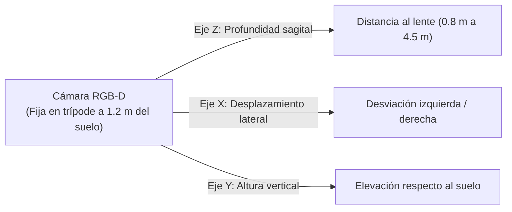
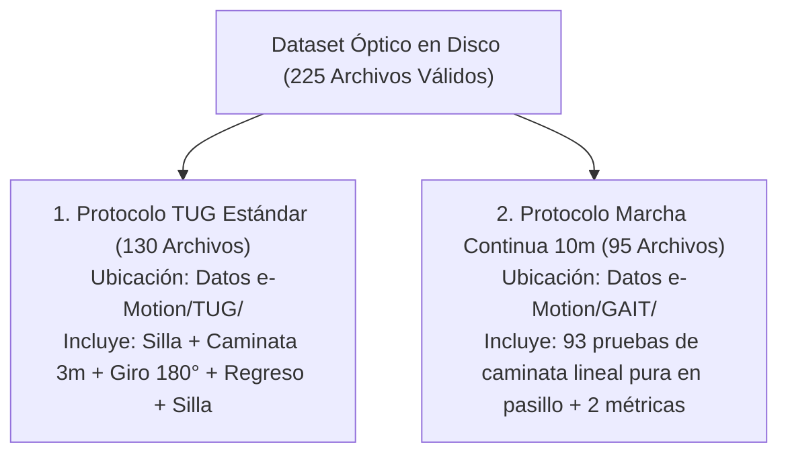
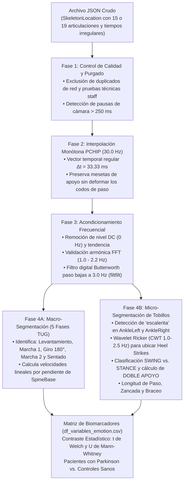
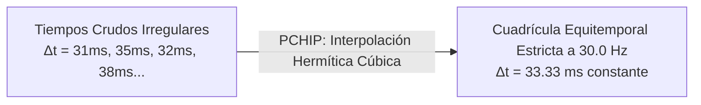
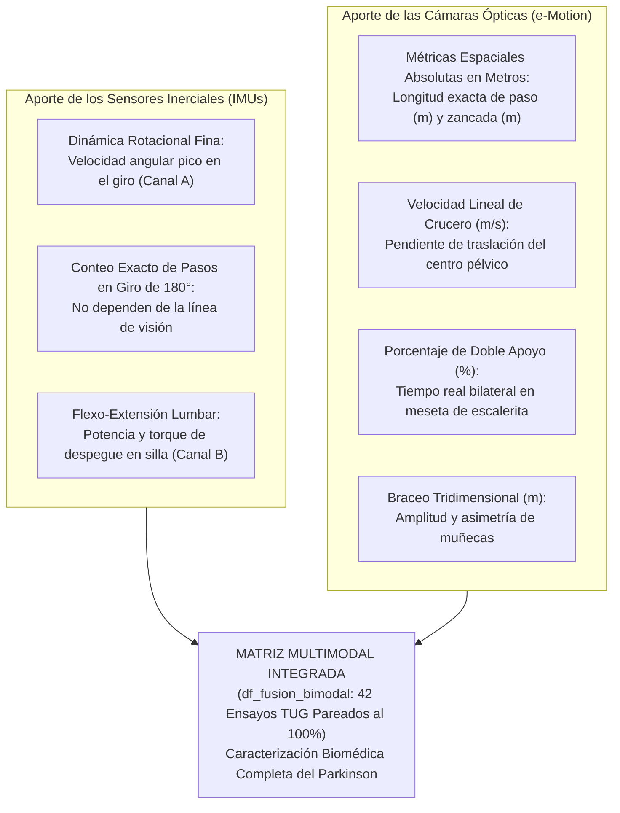

# GUIA: PIPELINE ÓPTICO e-MOTION (VIMOV)
> **Proyecto de Grado:** Caracterización Cinemática y Clasificación del Test *Timed Up and Go* (TUG) en la Enfermedad de Parkinson Mediante Sensores Inerciales y Cámaras de Profundidad RGB-D
> **Propósito del Documento:** Explicar paso a paso, con lenguaje claro, riguroso y didáctico, qué hace cada componente del pipeline óptico, qué significa cada variable biomecánica, cómo interpretar los gráficos y tablas, y qué implicaciones clínicas se deducen cuando un valor es mayor o menor entre un paciente y una persona sana.
> **Fecha de Actualización:** 02 de Noviembre de 2026
> **Archivos de Respaldo:** [`Datos e-Motion/Analisis_eMotion.md`](file:///home/guarinve/Documentos/PDG-TUG/Datos%20e-Motion/Analisis_eMotion.md), [`Datos e-Motion/FichaTecnica_eMotion.md`](file:///home/guarinve/Documentos/PDG-TUG/Datos%20e-Motion/FichaTecnica_eMotion.md), [`Datos e-Motion/df_variables_emotion.csv`](file:///home/guarinve/Documentos/PDG-TUG/Datos%20e-Motion/df_variables_emotion.csv) y [`Analisis de Datos/PDGI_Colab.ipynb`](file:///home/guarinve/Documentos/PDG-TUG/Analisis%20de%20Datos/PDGI_Colab.ipynb).

---

## 1. Introducción Intuitiva: ¿Qué es el Sistema e-Motion y Para Qué Sirve?

Imaginemos que estamos filmando a una persona caminando en un pasillo médico. Una cámara convencional graba un video compuesto de píxeles de color en dos dimensiones (ancho y alto). Si quisiéramos saber cuántos metros avanzó la persona o a qué distancia exacta del suelo estuvo su pie, tendríamos serias dificultades de perspectiva.

El sistema **e-Motion / VIMOV** utiliza **cámaras de profundidad RGB-D** (como las cámaras Intel RealSense D455 y Orbbec Astra 2). Estas cámaras no solo capturan la imagen visual, sino que emiten patrones de luz infrarroja invisibles que rebotan en el cuerpo humano, midiendo el tiempo de vuelo o la deformación del haz de luz. Con esto, la cámara calcula la **posición tridimensional exacta en metros $(X, Y, Z)$** de las articulaciones del cuerpo humano 30 veces por segundo:



* **Eje $Z$ (Profundidad sagital):** Es la distancia frontal entre la persona y la cámara. En la prueba TUG, la silla se coloca a $\approx 4.0\text{--}4.2\text{ metros}$ de la cámara ($Z \approx 4.0\text{ m}$), la persona se levanta, camina hacia el frente acercándose hasta $\approx 1.0\text{ metro}$ ($Z \approx 1.0\text{ m}$), da la vuelta de $180^\circ$ y regresa alejándose hacia los $4.0\text{ metros}$ para volver a sentarse.
* **Eje $Y$ (Eje vertical):** Mide la altura de la articulación respecto al suelo. Cuando la persona está sentada, su cadera y cabeza bajan; cuando se pone de pie, suben.
* **Eje $X$ (Eje transversal o lateral):** Mide cuánto se desplaza la persona hacia la izquierda o hacia la derecha de la línea central de la cámara.

---

## 2. Los Dos Protocolos del Dataset: ¿Por qué hay Dos Carpetas?

En el repositorio encontramos dos carpetas complementarias:



### ¿Por qué se analizan ambos protocolos por separado?
1. **La prueba TUG (`Datos e-Motion/TUG/`, 130 capturas):** Es una prueba clínica integral de movilidad funcional. Exige incorporar transiciones posturales complejas (levantarse, acelerar, frenar, rotar $180^\circ$ sobre su propio eje, retornar y sentarse).
2. **La prueba de Marcha Continua (`Datos e-Motion/GAIT/`, 93 capturas esqueléticas):** Al paciente se le pide caminar en línea recta a lo largo de un pasillo de 10 metros sin girar ni sentarse. Esto permite medir la marcha en **estado estacionario puro** (sin la perturbación ni desaceleración de la silla o del giro cerrado).
3. **El hallazgo clínico de los 48 pacientes apareados:** Descubrimos que **48 pacientes con Parkinson fueron evaluados en ambos protocolos el mismo día**. Esto permite comparar cómo camina el mismo sujeto en línea recta frente a cómo camina cuando tiene la exigencia motora de realizar el TUG.

---

## 3. Arquitectura del Pipeline: Las 4 Fases de Procesamiento Paso a Paso

El siguiente diagrama ilustra el viaje que realiza una señal desde que entra el archivo JSON crudo hasta que se obtienen los resultados clínicos:



---

## 4. Fase 1: Control de Calidad Determinístico y Purgado de Datos

Antes de aplicar cualquier fórmula matemática, es imperativo garantizar que los datos sean auténticos, limpios y representativos de pacientes reales:

### ¿Qué se descubrió y qué se eliminó físicamente del disco?
1. **Pruebas de Personal Técnico Interno (`i2t_staff`):**
   * Dos grabaciones (`SMR_20260625_NO_IMU_447fcdb7` y `c8ce4ec2`) pertenecían al usuario técnico `i2t_staff`. Fueron realizadas por los ingenieros de soporte al encender y calibrar la cámara en el hotel o salón de la brigada. No eran pacientes ni controles clínicos. **Fueron eliminadas.**
2. **Réplicas de Sincronización en Nube VIMOV (`DESCARTADO_DUPLICADO_API`):**
   * Debido a cortes intermitentes de red wifi en la brigada de Santa Marta, la aplicación de escritorio de VIMOV intentó re-sincronizar archivos al día siguiente. Esto creó 42 registros duplicados que tenían un nuevo `test_id` en la base de datos pero **exactamente los mismos fotogramas esqueléticos** que la prueba del día anterior. Si no se eliminaban, estaríamos contando dos veces a la misma persona en el análisis estadístico. **Fueron eliminadas.**
3. **El Censo Limpio Actual:**
   * El repositorio quedó exactamente con **225 archivos**:
     * **130 grabaciones TUG** (102 pacientes con Parkinson, 3 controles de brigada, 23 controles de calibración en laboratorio y 2 sin clasificar).
     * **95 grabaciones de Marcha Continua** (93 series esqueléticas válidas: 83 pacientes y 6 controles + 2 archivos tabulares de métricas comparativas).

---

## 5. Fase 2: Remuestreo Temporal e Interpolación Monótona PCHIP a 30.0 Hz

### El problema de la "No-Equitemporalidad" ($\Delta t$ irregular)
En un sistema ideal de laboratorio, una cámara de 30 FPS debería entregar un fotograma cada $33.33\text{ milisegundos}$ de forma exacta. Sin embargo, en el mundo real, los puertos USB, el procesamiento del sistema operativo y los cambios de iluminación hacen que el intervalo $\Delta t_k = t_k - t_{k-1}$ fluctúe: unos cuadros llegan a los $31\text{ ms}$, otros a los $35\text{ ms}$ e incluso en una toma (`9d0680ef`) el evaluador pausó la captura durante $81.34\text{ segundos}$.

Si ingresamos tiempos desiguales a algoritmos matemáticos como la Transformada de Fourier o filtros digitales, los cálculos de frecuencia y velocidad se distorsionan gravemente.



### ¿Por qué se utilizó PCHIP y no un *Spline* Cúbico tradicional?
* **El fenómeno de Runge y las mesetas de apoyo:** Cuando una persona apoya el pie en el suelo (fase de apoyo o `STANCE`), la coordenada $Z$ del tobillo se vuelve completamente plana (velocidad cero).
* Un *spline* tradicional, al intentar ajustar curvas polinómicas suaves de tercer orden, produce "ondas" u oscilaciones artificiales arriba y abajo de la meseta (efecto rebote). Esto haría creer falsamente que el pie se está moviendo cuando en realidad está quieto contra el piso.
* **PCHIP (*Piecewise Cubic Hermite Interpolating Polynomial*):** Es un algoritmo que respeta estrictamente la **monotonía local**. Si tres puntos son planos o monótonos, la curva interpolada se mantiene plana y sus derivadas se anulan en los bordes, preservando perfectamente los "codos" donde el pie despega del suelo.

---

## 6. Fase 3: Acondicionamiento Frecuencial (Remoción DC, Espectro FFT y Filtro Butterworth 3 Hz)

### 1. Remoción del Nivel DC y Tendencia
Cuando una persona camina alejándose o acercándose a la cámara, la señal contiene una rampa continua de varios metros. Para analizar las oscilaciones de los pasos, primero se sustrae la línea recta de traslación y el promedio ($0\text{ Hz}$ o corriente continua / DC). Esto deja únicamente la vibración cíclica de las piernas.

### 2. Validación por Transformada Rápida de Fourier (FFT)
Al calcular la FFT sobre la separación inter-tobillo $\Delta Z(t) = Z_{\text{AnkleLeft}}(t) - Z_{\text{AnkleRight}}(t)$, la física del cuerpo humano impone que el pico armónico principal de la marcha de adultos mayores se ubique entre **$1.0\text{ y }2.2\text{ Hz}$** (lo que equivale a dar entre 60 y 130 pasos por minuto).
* **Verificación empírica en nuestro dataset:** El pico dominante se ubicó en un promedio de **$1.44 \pm 0.31\text{ Hz}$** ($\approx 88.9\text{ pasos por minuto}$), confirmando que las señales representan fielmente la cadencia humana.

### 3. Filtro Butterworth Paso Bajas a $3.0\text{ Hz}$ (`filtfilt`)
Los sensores de profundidad RGB-D presentan un ruido de cuantización de alta frecuencia (pequeños temblores aleatorios de milímetros en cada fotograma). Como ningún ser humano puede oscilar sus piernas a más de 3 ciclos por segundo (3 Hz) durante una caminata, todo lo que esté por encima de $3.0\text{ Hz}$ es ruido óptico instrumental.
* Se aplica un filtro digital Butterworth de orden 4 a $3.0\text{ Hz}$ con filtrado bidireccional de fase cero (`filtfilt`), eliminando el ruido sin retrasar ni adelantar en el tiempo los instantes de pisada.

---

## 7. Fase 4A: Macro-Segmentación de las 5 Fases del TUG en Cámara

Una de las preguntas más importantes que se formularon fue: *¿Qué fases del TUG se pueden ver realmente en la cámara y qué pasa con el giro y el sentado?*

La respuesta matemática y anatómica que construimos en el pipeline divide la prueba en 5 fases delimitadas por la cinemática de la pelvis (`SpineBase`), cabeza (`Head`) y tobillos:

```
Distancia Z (m)
  ^
  |        [Fase 1: Levantamiento]                           [Fase 5: Sentado]
  |         (Silla a ~4.2m, Ey alto)                          (Silla a ~4.2m, Ey alto)
4m+-------/------------------------\                       /------------------------\
  |      /                          \                     /                          \
  |     /   [Fase 2: Marcha 1 Ida]   \                   /   [Fase 4: Marcha 2]       \
  |    /     (vz < 0, acercándose)    \                 /     (vz > 0, alejándose)     \
2m+   /                                \               /                                \
  |  /                                  \             /                                  \
  | /                                    \___________/                                    \
1m+---------------------------------------[Fase 3: Giro]-----------------------------------+
  |                                        (Inversión de signo vz, oclusión a <1.2m)
  +----------------------------------------------------------------------------------------> Tiempo (s)
```

### Detalle de cada una de las 5 fases:

#### 1. Fase 1: Levantamiento (`Sit-to-Stand`)
* **Qué hace el algoritmo:** Analiza la zona donde la persona está en la silla ($Z \ge 3.8\text{ m}$). Calcula la energía cinética vertical $E_y(t) = \frac{1}{2}(v_{y,\text{pelvis}}^2 + v_{y,\text{cabeza}}^2)$. Cuando la persona se incorpora, el tronco y la cabeza suben verticalmente entre $18\text{ y }42\text{ cm}$ ($\Delta Y$). El levantamiento se delimita desde que la energía vertical supera el $15\%$ de su pico hasta que la persona alcanza su altura erguida y comienza a avanzar.
* **Cobertura real demostrada:** El **$96.9\%$ de las pruebas TUG capturan el levantamiento** ($88.5\%$ de forma completa y $8.5\%$ parcial). Solo en 4 tomas ($3.1\%$) el operador inició la grabación tarde cuando el paciente ya estaba parado.

#### 2. Fase 2: Marcha 1 de Ida (Hacia la cámara)
* **Qué hace el algoritmo:** Detecta el avance monótono hacia la cámara donde la velocidad sagital de la pelvis es negativa ($v_{z,\text{SpineBase}} < -0.15\text{ m/s}$).
* **Cálculo de Velocidad Lineal:** Se ajusta una línea recta por regresión lineal sobre la trayectoria de profundidad ($Z$ vs. tiempo). La pendiente absoluta $|\Delta Z / \Delta t|$ representa la **velocidad lineal real en metros por segundo ($\text{m/s}$)**.
* **Cobertura:** Presente y válida en el **$100.0\%$ de los registros**.

#### 3. Fase 3: Zona de Giro de 180°
* **Qué hace el algoritmo:** Delimita el intervalo de tiempo exacto $[t_{\text{fin\_ida}}, t_{\text{ini\_vuelta}}]$ donde la persona alcanza el punto más cercano a la cámara ($Z_{\min} \approx 0.9\text{--}1.2\text{ m}$) e invierte su sentido de avance (la velocidad pasa de negativa a positiva).
* **El porqué de la delimitación metodológica:** Cuando la persona gira a menos de $1.2\text{ metros}$ de la cámara, su cuerpo cambia de plano sagital a frontal y sale parcialmente del cono angular del sensor. En el **$84.8\%$ de los casos, los tobillos sufren oclusión transitoria** (`NotTracked`). Por lo tanto:
  * **La cámara sí mide:** La **duración total del giro en segundos** (el tiempo que tarda en invertir la marcha).
  * **La cámara NO mide:** El número de pasos dentro del giro. El conteo de pasos en el giro se delega de manera exclusiva a los sensores IMU en los pies, que no dependen de la línea de visión óptica.

#### 4. Fase 4: Marcha 2 de Regreso (Hacia la silla)
* **Qué hace el algoritmo:** Delimita el trayecto donde la persona camina de espaldas a la cámara regresando hacia la silla ($v_{z,\text{SpineBase}} > +0.15\text{ m/s}$).
* **Cálculo de Velocidad Lineal:** Ajusta la pendiente de regresión lineal. Permite contrastar si la persona camina más despacio después de haber realizado el giro.
* **Cobertura:** Presente y válida en el **$100.0\%$ de los registros**.

#### 5. Fase 5: Sentado (`Stand-to-Sit`)
* **Qué hace el algoritmo:** Al llegar nuevamente a la silla ($Z \ge 3.8\text{ m}$), el algoritmo detecta el descenso vertical de la pelvis y la cabeza mediante la envolvente de energía $E_y(t)$.
* **Cobertura real demostrada:** El **$100.0\%$ de las grabaciones registran el descenso** ($84.6\%$ completas con descenso vertical $\Delta Y \ge 0.18\text{ m}$ y $15.4\%$ parciales al cortarse el video justo cuando la persona terminaba de sentarse).

---

## 8. Fase 4B: Micro-Segmentación de Tobillos ("Escalerita", CWT Ricker y Doble Apoyo)

Esta es la sección central para responder a la recomendación biomecánica del proyecto: **¿Cómo ve la cámara los pasos y cómo se calcula el Doble Apoyo?**

### 1. La Morfología en "Escalerita"
Si graficamos la profundidad en metros de los dos tobillos a lo largo del tiempo, observamos una figura geométrica idéntica a dos escaleras entrelazadas:

```
Profundidad Z (m)
  ^
  |                     /=========== (Tobillo Izq: STANCE, pie apoyado quieto)
  |       /=========== /             (Tobillo Der: SWING, rampa en el aire)
  |      /            /
  | ====/============/               (Codo de cruce = ambos pies a la par)
  |    /             /
  |   /=============                 (Tobillo Der: STANCE, pie apoyado quieto)
  +------------------------------------------------------------------------> Tiempo (s)
```

* **La Meseta Horizontal (Velocidad casi cero):** Durante aproximadamente $0.4\text{ a }0.6\text{ segundos}$, el pie está plantado en el piso sosteniendo el peso del cuerpo. Esta es la **Fase de Apoyo o `STANCE`**.
* **La Rampa Inclinada (Pendiente pronunciada):** El pie se despega del suelo, vuela hacia adelante a gran velocidad rebasando la cadera y vuelve a tocar el piso. Esta es la **Fase de Balanceo o `SWING`**.
* **El "Codo" de la escalerita:** Es el punto exacto de quiebre donde la rampa se convierte en meseta (**contacto de talón o *Heel Strike***) o donde la meseta se convierte en rampa (**despegue de dedos o *Toe-Off***).

### 2. Detección de los "Codos" mediante la Wavelet Ricker (CWT)
¿Cómo sabe una computadora exactamente en qué milisegundo ocurrió el "codo" de la pisada?
* El pipeline utiliza la **Transformada Wavelet Continua (CWT)** con la wavelet madre de **Ricker (*Mexican Hat*)** en la banda de $1.0\text{ a }2.5\text{ Hz}$.
* Matemáticamente, la wavelet de Ricker es la segunda derivada negativa de una campana gaussiana. Al deslizarse sobre la señal de los tobillos, su valor matemático se maximiza de forma exacta en los puntos de **máxima curvatura o aceleración brusca** (los "codos" de contacto de talón), permitiendo fechar cada pisada con precisión de milisegundos sin confundirla con el vaivén natural del tronco.

### 3. ¿Qué es el Doble Apoyo (*Double Support*) y Cómo se Calcula?
El ciclo de la marcha humana tiene dos estados posibles:
1. **Apoyo Simple:** Un pie está en el aire balanceándose (`SWING`) y el otro está en el suelo (`STANCE`).
2. **Doble Apoyo (*Double Support*):** Hay un breve instante en el que **ambos pies están tocando el suelo simultáneamente**, transfiriendo el peso corporal de una pierna a la otra.

El algoritmo calcula el Doble Apoyo de forma booleana en cada cuadro temporal $t$:

$$\text{DobleApoyo}(t) = \text{Stance}_{\text{PieIzquierdo}}(t) \;\land\; \text{Stance}_{\text{PieDerecho}}(t)$$

$$\%\text{DobleApoyo} = \frac{\text{Tiempo total con ambos pies en el suelo}}{\text{Tiempo total de caminata activa}} \times 100\%$$

* **El significado biomecánico vital:** Cuando una persona camina rápido y con total confianza, el tiempo que pasa con los dos pies apoyados es corto (flota más tiempo de un pie al otro). Cuando una persona siente debilidad muscular, rigidez, miedo a caerse o pérdida de equilibrio, **alarga desesperadamente el tiempo que pasa con ambos pies apoyados en el suelo** para sentirse segura.

---

## 9. Diccionario Exhaustivo de Variables Biomecánicas: ¿Qué Significa Cada Dato?

A continuación se detalla cada una de las variables que se extraen en [`df_variables_emotion.csv`](file:///home/guarinve/Documentos/PDG-TUG/Datos%20e-Motion/df_variables_emotion.csv), su unidad de medida y qué se deduce cuando el valor es mayor o menor:

| Nombre de la Variable | Unidad | ¿Qué Mide Físicamente? | Si es MAYOR en el paciente... | Si es MENOR en el paciente... |
|:---|:---:|:---|:---|:---|
| **`dur_activa_s`** | Segundos (s) | Tiempo total que la persona tarda en realizar la prueba activa (desde que empieza a levantarse hasta que termina de sentarse). | **Patología motora / Lentitud:** Indica bradicinesia, dificultad para moverse o fragilidad. | Agilidad normal, marcha rápida y fluida. |
| **`stride_length_mean_m`** *(Longitud de Zancada)* | Metros (m) | Distancia que recorre un mismo pie entre dos pisadas consecutivas (dos pasos completos: izquierdo $\to$ derecho $\to$ izquierdo). | Zancada amplia, propia de personas jóvenes y sanas. | **Hipocinesia cardinal de Parkinson:** Pasos cortos, marcha festinante o arrastre de pies ($p = 0.0032$). |
| **`step_length_mean_m`** *(Longitud de Paso)* | Metros (m) | Distancia horizontal entre el talón izquierdo y el talón derecho en el instante de pisada (un solo paso). | Amplitud normal de paso. | **Paso corto patológico ($p = 0.0034$):** Dificultad para extender la cadera y despegar el pie. |
| **`pct_doble_apoyo`** *(% Doble Apoyo)* | Porcentaje (%) | Proporción de la caminata en la que ambos pies están apoyados simultáneamente en el suelo. | **Inestabilidad postural y miedo a caer ($p = 0.0206$):** El paciente "se pega al suelo" para no perder el equilibrio. | Marcha dinámica normal ($18\%$). |
| **`amp_braceo_mean_m`** *(Amplitud de Braceo)* | Metros (m) | Rango de oscilación adelante/atrás de las muñecas respecto a la cadera mientras camina. | Braceo amplio, simétrico y armónico. | **Rigidez parkinsoniana ($p = 0.0065$):** Pérdida de balanceo del brazo al caminar (signo precoz de EP). |
| **`asimetria_braceo_pct`** | Porcentaje (%) | Diferencia relativa de amplitud de braceo entre el brazo izquierdo y el brazo derecho. | **Lateralidad clínica típica ($p = 0.0347$):** Un brazo casi no se mueve mientras el otro aún oscila. | Simetría normal entre ambos brazos. |
| **`vel_ida_ms`** y **`vel_vuelta_ms`** | m/s | Velocidad lineal de traslación del centro pélvico en los tramos rectos de ida y regreso. | Caminata rápida y eficiente. | **Enlentecimiento locomotor:** Incapacidad de generar velocidad de crucero en pasillo. |
| **`dur_marcha_vuelta_s`** | Segundos (s) | Tiempo que tarda en recorrer los 3 metros de regreso después de haber dado la vuelta de $180^\circ$. | **Fatiga o desorientación post-giro ($p = 0.0378$):** El regreso le cuesta más tiempo que la ida. | Retorno ágil y continuo hacia la silla. |
| **`cadencia_ppm`** | Pasos/min | Ritmo o número de pasos que da la persona por minuto. | Pasos muy rápidos y cortitos (festinación). | Ritmo pausado. En nuestra cohorte **no difiere ($p = 0.66$)**: el paciente camina lento porque achica el paso, no por el ritmo. |
| **`swing_mean_s`** | Segundos (s) | Duración media del pie en el aire durante cada paso. | Pie flota más tiempo en el aire (marcha atlética). | Pie cae rápidamente al suelo por debilidad o inseguridad. |
| **`stance_mean_s`** | Segundos (s) | Duración media del pie plantado en el suelo. | Prolongación del contacto con el suelo (cautela). | Despegue dinámico y enérgico del pie. |

---

## 10. Análisis de los Resultados Estadísticos: ¿Qué Demuestran las Tablas?

Al correr las pruebas inferenciales (*t* de Welch para muestras con varianzas desiguales y *U* de Mann-Whitney) sobre las **223 muestras clínicas aceptadas**, los datos arrojan diferencias estadísticas contundentes con significancia clínica ($p < 0.05$):

### 1. Tabla de Contraste en Protocolo TUG ($n = 130$ Capturas: 102 Pacientes EP vs. 26 Controles)

| Biomarcador Óptico | Pacientes con Parkinson ($\mu \pm \sigma$) | Controles Sanos ($\mu \pm \sigma$) | Diferencia Absoluta | Valor $p$ (*t* de Welch) | ¿Qué se deduce clínicamente? |
|:---|:---:|:---:|:---:|:---:|:---|
| **Duración Activa TUG** | **$15.91 \pm 7.62\text{ s}$** | **$13.26 \pm 3.34\text{ s}$** | $+2.65\text{ s}$ ($+20.0\%$) | **$p = 0.0082^{**}$** | El paciente con Parkinson tarda significativamente más tiempo en realizar el recorrido completo. |
| **Longitud de Zancada** | **$0.839 \pm 0.167\text{ m}$** | **$0.949 \pm 0.172\text{ m}$** | $-0.110\text{ m}$ ($-11.0\text{ cm}$) | **$p = 0.0032^{**}$** | **El biomarcador espacial más potente:** El Parkinson acorta la zancada en $11\text{ cm}$ promedio. |
| **Longitud de Paso (vs Brigada)** | **$0.353 \pm 0.064\text{ m}$** | **$0.422 \pm 0.039\text{ m}$** | $-0.069\text{ m}$ ($-6.9\text{ cm}$) | **$p = 0.0034^{**}$** | En igualdad de condiciones de brigada médica, el paso del paciente es casi $7\text{ cm}$ más corto. |
| **Amplitud de Braceo** | **$0.270 \pm 0.085\text{ m}$** | **$0.315 \pm 0.073\text{ m}$** | $-0.045\text{ m}$ ($-14.3\%$) | **$p = 0.0065^{**}$** | Pérdida evidente del balanceo de brazos debido a la rigidez axial y braquial. |
| **Asimetría de Braceo** | **$22.74 \pm 14.90\%$** | **$16.71 \pm 12.46\%$** | $+6.03\%$ | **$p = 0.0347^{*}$** | Un brazo bracea notablemente menos que el otro, reflejando el inicio asimétrico de la enfermedad. |
| **Duración Marcha Regreso** | **$7.18 \pm 3.18\text{ s}$** | **$6.22 \pm 1.72\text{ s}$** | $+0.96\text{ s}$ ($+15.4\%$) | **$p = 0.0378^{*}$** | El paciente sufre un enlentecimiento tras el giro: regresar a la silla le cuesta casi 1 segundo más. |

---

### 2. Tabla de Contraste en Marcha Continua de 10 Metros ($n = 93$ Capturas: 83 Pacientes EP vs. 6 Controles de Brigada)

Cuando retiramos la silla y el giro de $180^\circ$ y dejamos que la persona camine libremente en línea recta durante 10 metros, los datos revelan el biomarcador más puro de la inestabilidad postural:

| Biomarcador en Marcha Continua | Pacientes con Parkinson ($\mu \pm \sigma$) | Controles Sanos de Brigada ($\mu \pm \sigma$) | Estadístico $t$ | Valor $p$ (*t* de Welch) | ¿Qué se deduce clínicamente? |
|:---|:---:|:---:|:---:|:---:|:---|
| **Porcentaje de Doble Apoyo (`pct_doble_apoyo`)** | **$25.07 \pm 7.32\%$** | **$18.23 \pm 6.96\%$** | **$+2.31$** | **$p = 0.0206^{*}$** | **Hallazgo Maestro:** Mientras una persona sana pasa el $18.2\%$ del tiempo con ambos pies en el suelo, el paciente con Parkinson eleva este tiempo al **$25.1\%$ (un $+37.5\%$ más)** para no perder el equilibrio. |
| **Duración Activa de Marcha** | **$19.30 \pm 9.50\text{ s}$** | **$14.27 \pm 4.03\text{ s}$** | $+2.58$ | **$p = 0.0099^{**}$** | El paciente requiere casi 5 segundos adicionales para recorrer los 10 metros. |
| **Cadencia Óptica** | $91.47 \pm 15.21\text{ ppm}$ | $93.50 \pm 10.56\text{ ppm}$ | $-0.44$ | $p = 0.6612$ (No signif.) | **Demostración de que la cadencia no cambia:** El paciente da casi el mismo número de pasos por minuto que una persona sana; camina más despacio **porque sus pasos son más cortos y pasa más tiempo con los dos pies apoyados**. |

---

## 11. Interpretación de los Gráficos del Cuaderno: ¿Cómo Explicar Cada Panel?

Cuando abrimos [`Analisis de Datos/PDGI_Colab.ipynb`](file:///home/guarinve/Documentos/PDG-TUG/Analisis%20de%20Datos/PDGI_Colab.ipynb) y ejecutamos los Módulos 11, 12 y 13, se despliegan tres paneles gráficos fundamentales:

### 1. Panel de Macro-Segmentación (Módulo 11 — 3 Gráficos Verticales)
* **Gráfico Superior (Curva Azul en forma de 'U' o 'V'):** Muestra la distancia $Z$ del centro del cuerpo a la cámara.
  * Comienza arriba en $4\text{ metros}$ (silla).
  * La línea desciende rápidamente mientras la persona camina hacia el frente (**Marcha 1**).
  * Llega al valle inferior en $\approx 1.0\text{ metro}$ (**Zona de Giro de 180°**).
  * La línea vuelve a subir mientras regresa a la silla (**Marcha 2**).
  * Las **líneas discontinuas negras** representan la pendiente lineal $|\Delta Z/\Delta t|$: cuanto más inclinada sea la línea, mayor es la velocidad en $\text{m/s}$.
* **Gráfico Medio (Curva Verde de Altura y Área Naranja de Energía):**
  * La curva verde es la elevación vertical del tronco.
  * El área sombreada naranja es la **energía vertical $E_y(t)$**. Al inicio vemos un gran pico de energía cuando el paciente hace fuerza para ponerse de pie (**Levantamiento**), y al final vemos otro pico cuando flexiona las rodillas para frenar su caída contra la silla (**Sentado**).
* **Gráfico Inferior (Espectro FFT Rojo):**
  * Muestra las frecuencias presentes en la caminata.
  * La franja verde ($1.0\text{--}2.2\text{ Hz}$) resalta la zona fisiológica de los pasos humanos.
  * La línea vertical punteada azul en $3.0\text{ Hz}$ demuestra cómo el filtro corta todo el ruido de alta frecuencia que esté por encima.

---

### 2. Panel de Micro-Segmentación y Doble Apoyo (Módulo 12 — 3 Gráficos Verticales)
* **Gráfico Superior (Las dos "Escaleritas" Azul y Roja):**
  * La línea azul es el tobillo izquierdo y la línea roja es el tobillo derecho.
  * Cada escalón horizontal plano es un momento donde ese pie estuvo quieto en el suelo (**`STANCE`**).
  * Cada tramo empinado es cuando el pie voló hacia adelante (**`SWING`**).
  * Los puntos redondos en los codos son los contactos de talón (*Heel Strikes*) detectados por la Wavelet de Ricker. La distancia vertical entre un punto azul y un punto rojo en el mismo segundo es la **longitud del paso en metros**.
* **Gráfico Medio (Separación Inter-Tobillo y Energía Wavelet Púrpura):**
  * La línea verde oscila arriba y abajo de cero a medida que el pie izquierdo rebasa al derecho y viceversa.
  * La curva púrpura muestra los picos de energía de la Wavelet Ricker, confirmando cómo se resaltan los impactos de talón.
* **Gráfico Inferior (Barras Horizontales de Estados de Marcha):**
  * Barra superior azul: cuándo el pie izquierdo está en el aire o en el suelo.
  * Barra intermedia roja: cuándo el pie derecho está en el aire o en el suelo.
  * **Barra inferior dorada/amarilla (`DOBLE APOYO`):** Se enciende únicamente en los momentos donde **ambos pies coinciden en el suelo al mismo tiempo**. Se aprecia con total claridad cómo en los pacientes con Parkinson estas franjas doradas son notablemente más anchas y frecuentes que en los controles sanos.

---

### 3. Panel de Diagramas de Caja (*Boxplots* del Módulo 13 — 4 Cuadros Comparativos)
* **Boxplot 1 (Longitud de Zancada):** La caja azul de los pacientes con Parkinson está situada visiblemente más abajo que la caja gris de los controles sanos ($0.84\text{ m}$ vs $0.95\text{ m}$, $p = 0.0032$). Demuestra la hipocinesia espacial.
* **Boxplot 2 (Amplitud de Braceo):** La caja verde de los pacientes está comprimida hacia abajo respecto a los controles ($0.27\text{ m}$ vs $0.32\text{ m}$, $p = 0.0065$). Demuestra la rigidez motora superior.
* **Boxplot 3 (Duración Activa TUG):** La caja naranja de los pacientes está desplazada hacia arriba ($15.91\text{ s}$ vs $13.26\text{ s}$, $p = 0.0082$), reflejando lentitud general.
* **Boxplot 4 (Porcentaje de Doble Apoyo en Marcha 10m):** La caja morada de los pacientes se eleva significativamente hasta el $25.1\%$ frente al $18.2\%$ de los controles ($p = 0.0206$). Demuestra la compensación por inestabilidad postural.

---

## 12. La Fusión Multimodal: La Unión Perfecta entre IMUs y Cámaras

Para cerrar con máxima solidez metodológica, este análisis responde a la pregunta de por qué el proyecto combina dos tecnologías diferentes en lugar de usar solo una:



1. **Lo que la cámara hace mejor que el IMU:** Mide distancias espaciales reales en el suelo en metros (el IMU no puede medir metros directamente sin acumular deriva por doble integración numérica), calcula la velocidad lineal en $\text{m/s}$, cuantifica el Doble Apoyo bilateral y mide el braceo de los brazos.
2. **Lo que el IMU hace mejor que la cámara:** Monitorea la rotación pura del cuerpo durante el giro de $180^\circ$ (donde la cámara sufre oclusión de piernas por proximidad al lente) y mide los ángulos de inclinación del tronco al despegar de la silla.
3. **El Resultado Final:** Los **42 pares bimodales estrictamente confirmados y sincronizados** combinan lo mejor de ambos mundos, cumpliendo con creces los objetivos de investigación de pregrado y ofreciendo biomarcadores estadísticamente sólidos antes del cierre de semestre.

