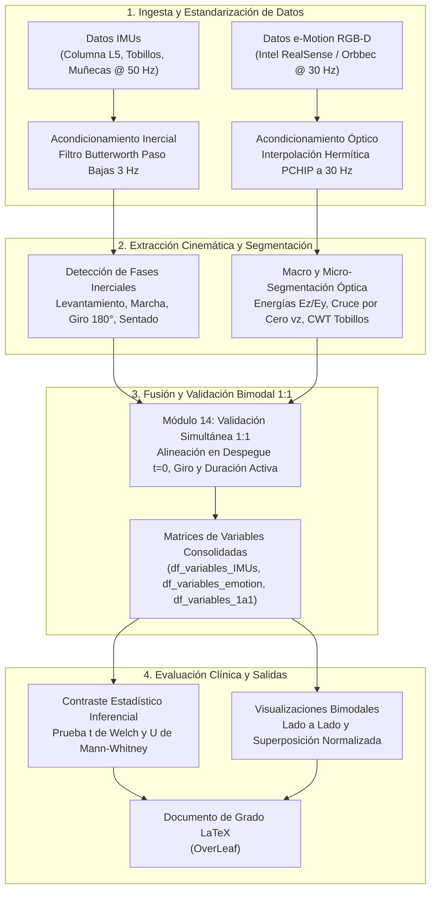

# Análisis Cinemático y Biomecánico Bimodal del Test Timed Up and Go (PDG-TUG)

      

Proyecto de Grado en Ingeniería Telemática e Ingeniería de Sistemas de la Universidad ICESI, orientado al procesamiento de señales, análisis cinemático y fusión sensorial bimodal de la prueba motora *Timed Up and Go* (TUG) y marcha continua para la caracterización biomecánica en personas mayores y pacientes con Enfermedad de Parkinson frente a controles sanos.

El sistema procesa y contrasta dos modalidades complementarias: sensores inerciales corporales (IMUs triaxiales en columna lumbar y extremidades a 50 Hz) especializados en transiciones posturales y giros, y cámaras ópticas de profundidad RGB-D (Intel RealSense y Orbbec Astra 2 a 30 Hz procesadas en VIMOV) para la estimación de longitudes de zancada, velocidades lineales y cadencia espacial.

---

## Tabla de Contenidos
- [Estructura del Proyecto](#estructura-del-proyecto)
- [Tecnologías Utilizadas](#tecnologías-utilizadas)
- [Arquitectura del Sistema](#arquitectura-del-sistema)
- [Requisitos Previos](#requisitos-previos)
- [Inicialización Rápida](#inicialización-rápida)
- [Cómo Contribuir](#cómo-contribuir)
- [Equipo](#equipo)

---

## Estructura del Proyecto

```text
PDG-TUG/
├── Analisis de Datos/            # Entorno analítico interactivo y scripts de procesamiento
│   ├── PDG_I_Int.ipynb           # Cuaderno interactivo con vista de formularios y filtros configurables
│   ├── PDGI_Colab.ipynb          # Cuaderno analítico principal con código completo (Pipelines 1, 2 y 3)
│   ├── PDG_II_Predecesor.ipynb   # Cuaderno de referencia con algoritmos del proyecto previo
│   └── Script/                   # Utilidades de cruce bimodal y fichas técnicas
├── Datos IMUs/                   # Repositorio inercial estructurado (78 grabaciones)
│   ├── README.md                 # Guía del repositorio inercial y nomenclatura JSON
│   ├── IMUS/                     # Archivos JSON crudos adquiridos con sensores inerciales
│   ├── Inventario_IMUs.csv       # Catálogo unificado con metadatos clínicos esenciales
│   ├── SegmentacionFases_IMUs.csv# Intervalos y duraciones de las 5 fases y pasos
│   ├── df_variables_IMUs.csv     # Matriz de variables técnicas y biomarcadores inerciales
│   ├── FichaTecnica_IMUs.md      # Protocolo técnico y criterios determinísticos de descarte
│   └── Analisis_IMUs.md          # Reporte técnico e inferencial del conjunto inercial
├── Datos e-Motion/               # Repositorio óptico RGB-D VIMOV (225 grabaciones)
│   ├── README.md                 # Guía del repositorio óptico y nomenclatura JSON
│   ├── TUG/                      # 130 capturas articulares de la prueba Timed Up and Go
│   ├── GAIT/                     # 95 capturas articulares de marcha continua de 10 metros
│   ├── Inventario_eMotion.csv    # Catálogo de 225 registros ópticos normalizados
│   ├── df_variables_emotion.csv  # Matriz de 53 biomarcadores espaciotemporales
│   ├── FichaTecnica_eMotion.md   # Especificación de esquemas articulares y cámaras
│   ├── Analisis_eMotion.md       # Evaluación de calidad y hallazgos estadísticos
│   └── Guia_Pipeline_eMotion.md  # Fundamentación matemática y metodológica 3D
├── Datos IMU&eMotion/            # Dataset bimodal sincronizado 1:1 de brigadas
│   ├── README.md                 # Guía del dataset bimodal 1:1 y nomenclatura JSON
│   ├── IMU&eMotion/              # 53 pares emparejados (106 archivos JSON simultáneos)
│   ├── Inventario_1a1.csv        # Catálogo de pares bimodales con desfases temporales
│   ├── df_variables_1a1.csv      # Matriz comparativa con 39 variables cruzadas
│   ├── FichaTecnica_1a1.md       # Criterios de correspondencia simultánea estricta
│   ├── Analisis_1a1.md           # Correlación lineal de Pearson y concordancia física
│   └── Inventario_Brigada_1a1.json # Manifiesto estructurado exportado desde VIMOV
├── Notas_Reuniones/              # Minutas formales de seguimiento técnico y clínico
├── OverLeaf/                     # Manuscrito formal de grado en LaTeX
└── README.md                     # Carta de presentación pública del repositorio
```

---

## Tecnologías Utilizadas

| Tecnología / Herramienta | Tipo / Rol en el Proyecto | Versión / Estándar |
| :--- | :--- | :--- |
| **Python** | Lenguaje de programación base | 3.10+ |
| **NumPy** | Computación numérica y álgebra lineal vectorial | 1.24+ |
| **SciPy** | Procesamiento de señales (`butter`, `filtfilt`, `PchipInterpolator`, CWT) | 1.10+ |
| **Pandas** | Ingesta, consolidación de matrices tabulares y depuración | 2.0+ |
| **Matplotlib** | Visualización cinemática, gráficas superpuestas y diagramas | 3.7+ |
| **Google Colab** | Entorno interactivo de experimentación y validación bimodal | Cloud / Jupyter Notebook |
| **VIMOV Platform** | Ecosistema de telemetría médica (sensores LPMS B2, cámaras RGB-D) | Auth0 API / JSON Schema |
| **LaTeX / Overleaf** | Composición tipográfica del documento de tesis | TeX Live / Overleaf |

---

## Arquitectura del Sistema



---

## Requisitos Previos

| Componente / Herramienta | Versión Mínima | Configuración Mínima Requerida |
| :--- | :--- | :--- |
| **Python** | 3.10 | Intérprete disponible en entorno local o virtual (`venv`) |
| **Pip** | 23.0 | Gestor de paquetes configurado con acceso a repositorio estándar |
| **Google Chrome / Navegador Web** | Moderno | Compatible con ejecución de widgets interactivos en Google Colab |
| **Git** | 2.34 | Cliente configurado con acceso al repositorio remoto de GitHub |

---

## Inicialización Rápida

1. **Clonar el repositorio:**
   ```bash
   git clone https://github.com/TUGPDGII/PDG-TUG.git
   cd PDG-TUG
   ```

2. **Crear y activar el entorno virtual:**
   ```bash
   python3 -m venv .venv
   source .venv/bin/activate
   ```

3. **Instalar dependencias del proyecto:**
   ```bash
   pip install numpy scipy pandas matplotlib
   ```

4. **Abrir el cuaderno principal de análisis:**
   * En entorno local con Jupyter Notebook o VS Code:
     Abrir `PDG-TUG/Analisis de Datos/PDGI_Colab.ipynb`.
   * En Google Colab:
     Subir o vincular `PDG-TUG/Analisis de Datos/PDGI_Colab.ipynb` y ejecutar las celdas en orden secuencial.

---

## Cómo Contribuir

1. Clonar el repositorio y crear una rama de trabajo a partir de `main` con nombre descriptivo (`feature/nueva-variable` o `fix/correccion-segmentacion`).
2. Mantener la estructura cerrada de 4 documentos (`Analisis`, `df_variables`, `FichaTecnica`, `Inventario`) por cada repositorio de datos.
3. Asegurar que las referencias a rutas de archivos se originen siempre en `PDG-TUG/...` para preservar portabilidad.
4. Enviar un Pull Request documentando los cambios implementados y las verificaciones ejecutadas.

---

## Equipo

### Autores
* Esteban Guarin Valencia
* Juan José Arias Gallego
* Santiago Gómez Robledo
* Heiner Danit Rincón Carrillo

### Tutores
* Prof. Domiciano Rincón (Director — Track Clínico y Técnico)
* Prof. Andrés Navarro (Codirector — Track Académico y Metodológico)
