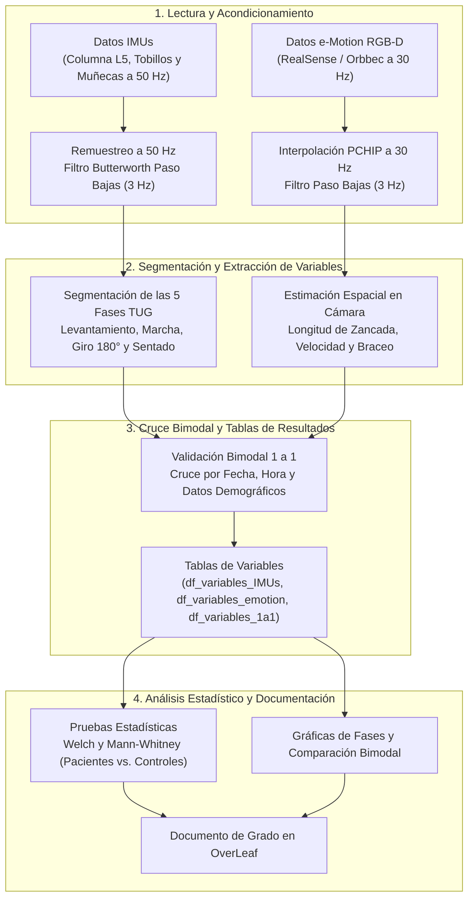

# Análisis Cinemático y Biomecánico Bimodal de la Prueba Timed Up and Go (PDG-TUG)

      

Proyecto de Grado en Ingeniería Telemática e Ingeniería de Sistemas de la Universidad Icesi, enfocado en el procesamiento de señales, segmentación por fases y análisis biomecánico de la prueba *Timed Up and Go* (TUG) y de marcha continua para caracterizar patrones motores en pacientes con enfermedad de Parkinson frente a sujetos de control.

El trabajo combina dos fuentes de captura recolectadas en brigadas médicas: sensores inerciales (IMUs triaxiales ubicadas en columna lumbar, tobillos y muñecas a 50 Hz) para identificar las transiciones posturales y la dinámica de los giros, y cámaras de profundidad RGB-D (Intel RealSense y Orbbec Astra 2 a 30 Hz en la plataforma VIMOV) para estimar longitud de zancada, velocidad lineal y variables espaciales de marcha.

---

## Tabla de Contenidos
- [Estructura del Proyecto](#estructura-del-proyecto)
- [Tecnologías Utilizadas](#tecnologías-utilizadas)
- [Flujo de Procesamiento](#flujo-de-procesamiento)
- [Requisitos Previos](#requisitos-previos)
- [Inicialización Rápida](#inicialización-rápida)
- [Guía de Trabajo en el Repositorio](#guía-de-trabajo-en-el-repositorio)
- [Equipo](#equipo)

---

## Estructura del Proyecto

```text
PDG-TUG/
├── Analisis de Datos/                        # Cuadernos de procesamiento, cruce bimodal y gestión de riesgos
│   ├── PDGI_Colab.ipynb                      # Cuaderno principal con el pipeline inercial, óptico y bimodal
│   ├── PDG_II_Predecesor.ipynb               # Cuaderno base con el algoritmo de segmentación del proyecto anterior
│   ├── Correlacion.md                        # Auditoría de correspondencia temporal entre registros IMU y cámara
│   ├── Matriz_Analisis_Riesgos.md            # Tabla oficial de análisis de riesgos del proyecto (vista web)
│   ├── Matriz_Analisis_Riesgos.csv           # Matriz de análisis de riesgos exportable a Excel / hojas de cálculo
│   ├── Presentacion_Avances_PDG_TUG.html     # Presentación interactiva de avances y matriz de riesgos (16 diapositivas)
│   ├── Presentacion_Avances_PDG_TUG.pptx     # Versión de la presentación en formato PowerPoint
│   ├── Guion_Exposicion_PDG.md               # Guion de apoyo por diapositiva para la sustentación de avances
│   └── Script/                               # Scripts auxiliares para cruce bimodal y generación de fichas técnicas
│       ├── generar_cruce_imu_emotion.py
│       ├── generar_ficha_tecnica_camara.py
│       ├── emotion_summary.json
│       ├── mapeo_renombramiento_emotion.json
│       └── records_summary.json
├── Datos IMUs/                               # Conjunto de datos de sensores inerciales (78 grabaciones)
│   ├── README.md                             # Descripción de la estructura y nomenclatura de los archivos IMU
│   ├── IMUS/                                 # Archivos JSON crudos capturados a ~50 Hz
│   ├── Inventario_IMUs.csv                   # Catálogo de grabaciones inerciales y datos demográficos
│   ├── Cruce_VIMOV_IMUs.csv                  # Relación de emparejamiento entre capturas IMU y registros VIMOV
│   ├── SegmentacionFases_IMUs.csv            # Tiempos de inicio, fin y duración de las 5 fases TUG y pasos
│   ├── df_variables_IMUs.csv                 # Matriz de variables biomecánicas extraídas de los sensores IMU
│   ├── FichaTecnica_IMUs.md                  # Criterios de control de calidad y descarte de muestras inerciales
│   └── Analisis_IMUs.md                      # Resultados descriptivos y pruebas estadísticas del bloque IMU
├── Datos e-Motion/                           # Conjunto de datos de cámaras RGB-D en VIMOV (225 grabaciones)
│   ├── README.md                             # Descripción de la estructura y nomenclatura de los archivos ópticos
│   ├── TUG/                                  # 130 grabaciones del protocolo Timed Up and Go (SMR, CST y LAB)
│   ├── GAIT/                                 # 95 grabaciones del protocolo de marcha continua de 10 m
│   ├── Inventario_eMotion.csv                # Catálogo general de las 225 capturas de cámara
│   ├── df_variables_emotion.csv              # Matriz de variables espaciotemporales extraídas en cámara
│   ├── FichaTecnica_eMotion.md               # Especificación de cámaras, versiones de esqueleto y descartes
│   ├── Analisis_eMotion.md                   # Evaluación de cobertura por fase y resultados estadísticos ópticos
│   └── Guia_Pipeline_eMotion.md              # Explicación del preprocesamiento y segmentación sobre datos 3D
├── Datos IMU&eMotion/                        # Subconjunto bimodal emparejado 1 a 1 de brigadas (53 pares)
│   ├── README.md                             # Guía del conjunto bimodal sincronizado
│   ├── IMU&eMotion/                          # 106 archivos JSON emparejados (53 tomas IMU + 53 tomas e-Motion)
│   ├── Inventario_1a1.csv                    # Tabla de pares confirmados con sus diferencias de tiempo
│   ├── Inventario_Brigada_1a1.json           # Resumen estructurado de los pares bimodales de brigada
│   ├── Auditoria_Anomalias_Bimodales.csv     # Registro de casos con diferencias de duración o cobertura entre equipos
│   ├── df_variables_1a1.csv                  # Matriz consolidada con variables inerciales y ópticas por par
│   ├── FichaTecnica_1a1.md                   # Criterios de validación del cruce simultáneo 1 a 1
│   └── Analisis_1a1.md                       # Comparación de tiempos y correlaciones entre IMU y cámara
├── Notas_Reuniones/                          # Actas y notas de seguimiento semanal con los tutores (Reuniones 3 a 8)
├── OverLeaf/                                 # Documento escrito de Proyecto de Grado en LaTeX
│   ├── PDG-II TUG.tex                        # Manuscrito principal (con tablas anchas en orientación horizontal)
│   ├── PDG-II TUG Vertical.tex               # Versión alternativa del manuscrito en formato vertical
│   ├── PDG-II TUG.pdf                        # Documento compilado en PDF
│   └── Imagenes/                             # Diagrama metodológico CRISP-DM y cronograma del proyecto
├── PDG_BACKLOG_PENDIENTES.md                 # Control de tareas e hitos semanales del equipo
└── README.md                                 # Documentación general del repositorio
```

---

## Tecnologías Utilizadas

| Herramienta | Uso en el proyecto | Versión |
| :--- | :--- | :--- |
| **Python** | Lenguaje base para los scripts y cuadernos de análisis | 3.10+ |
| **NumPy** | Manejo de arreglos y operaciones sobre series de tiempo | 1.24+ |
| **SciPy** | Filtrado Butterworth (`butter`, `filtfilt`), interpolación (`PchipInterpolator`), FFT y wavelets | 1.10+ |
| **Pandas** | Organización de catálogos, tablas de variables y limpieza de datos | 2.0+ |
| **Matplotlib** | Gráficas de señales, fases del TUG y comparaciones entre grupos | 3.7+ |
| **Google Colab** | Ejecución compartida de los cuadernos de experimentación | Jupyter Notebook |
| **VIMOV** | Plataforma de captura y almacenamiento de datos inerciales y de cámara | JSON / MinIO |
| **LaTeX / Overleaf** | Redacción del documento de Proyecto de Grado | TeX Live |

---

## Flujo de Procesamiento



---

## Requisitos Previos

| Componente | Versión mínima | Descripción |
| :--- | :--- | :--- |
| **Python** | 3.10 | Intérprete local o entorno virtual (`venv`) |
| **Pip** | 23.0 | Instalación de librerías científicas de Python |
| **Navegador Web / Jupyter** | Actualizado | Para abrir los cuadernos localmente o en Google Colab |
| **Git** | 2.34 | Control de versiones y sincronización con el repositorio |

---

## Inicialización Rápida

1. **Clonar el repositorio:**
   ```bash
   git clone https://github.com/TUGPDGII/PDG-TUG.git
   cd PDG-TUG
   ```

2. **Crear y activar el entorno virtual:**
   ```bash
   python3 -m venv .venv
   source .venv/bin/activate
   ```

3. **Instalar dependencias:**
   ```bash
   pip install numpy scipy pandas matplotlib
   ```

4. **Ejecutar los cuadernos de análisis:**
   * En local (VS Code o Jupyter): abrir `Analisis de Datos/PDGI_Colab.ipynb` o `Analisis de Datos/PDG_II_Predecesor.ipynb`.
   * En Google Colab: cargar el cuaderno correspondiente desde el repositorio y ejecutar las celdas en orden.

---

## Guía de Trabajo en el Repositorio

1. Crear una rama descriptiva a partir de `main` antes de realizar cambios (`feature/...` o `fix/...`).
2. Conservar los cuatro archivos base en cada carpeta de datos (`Inventario`, `FichaTecnica`, `Analisis` y `df_variables`).
3. Mantener las rutas relativas desde la raíz `PDG-TUG/` para que los scripts y cuadernos corran sin ajustes manuales.

---

## Equipo

### Autores
* Esteban Guarin Valencia
* Juan José Arias Gallego
* Santiago Gómez Robledo
* Heiner Danit Rincón Carrillo

### Tutores
* Prof. Domiciano Rincón (Director — Seguimiento Técnico y Clínico)
* Prof. Andrés Navarro (Codirector — Seguimiento Académico y Metodológico)
